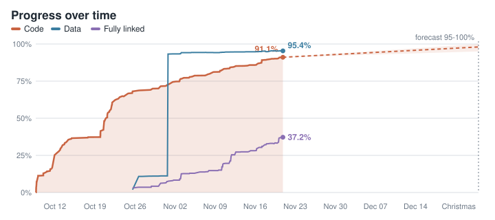
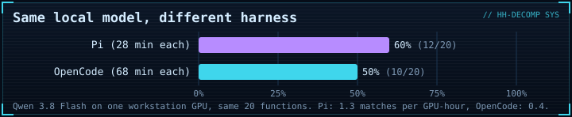
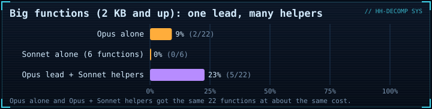
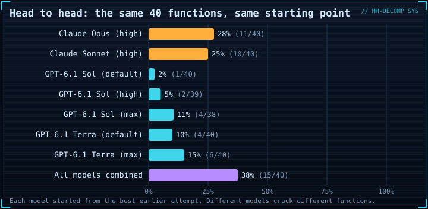
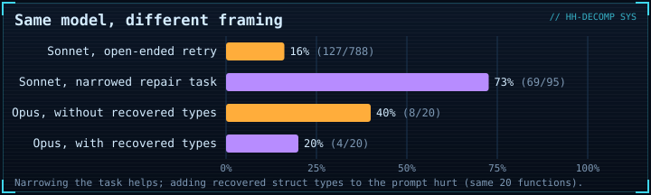
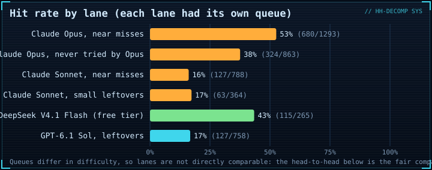

# Hybrid Heaven (N64) decompilation

A **matching decompilation** of *Hybrid Heaven* (Konami, 1999, USA) for the Nintendo 64: C source that compiles back to
a byte-identical ROM. It is also a **research project** on AI-driven decompilation: how far small and large models plus
good tooling get on real work, and what it costs. Every function is checked by the compiler, byte for byte.

[](https://decomp.dev/southcitycapture/hybridheaven-decomp)
· Live progress: [decomp.dev](https://decomp.dev/southcitycapture/hybridheaven-decomp) ·
[ByteMatch](https://bytematch.dev/southcitycapture/hybridheaven-decomp)

> **No game data is in this repository.** You need your own legally obtained ROM; disassembly is generated locally.

## Where it stands

| | Matched | |
|---|---:|---|
| **Code** | **92.87%** | 2,625,332 of 2,826,840 bytes |
| Functions | 98.7% | 15,721 of 15,934 |
| Data | 95.40% | 1,016,912 of 1,065,936 bytes |
| Fully linked | 39.09% | 277 of 544 source files complete |

_Updated 2026-11-22 23:09 UTC by the publishing loop._



**Fully linked** means a whole source file is C with nothing left in assembly, linked as a normal object. It trails
the code number because one unmatched function holds back its whole file.

## When will it be done?

Forecast as of 2026-11-22, re-estimated as the rate changes:

| Milestone | Estimate | Why |
|---|---|---|
| ~~80% of code~~ | reached 2026-11-08 | Fixing a bug in our match checker landed 28 already-solved functions at once. |
| ~~90% of code~~ | reached 2026-11-18 | Scoring every saved attempt directly turned up near-finished work, including three giant functions (7-11 KB) already at 99%+. |
| ~~All six giant functions~~ | **done 2026-11-22** | The last two (8.3 KB and 13.8 KB) fell to a relay: one model building the structure run after run, another finishing the register details. |
| 95% of code | late November | A planned multi-day push at the end of November on the remaining near-misses. |
| **Christmas 2026** | **98-100%** | What is left is about 210 functions of ordinary size; the method that cracked the giants works on them too. |

By function count we are much further along (98.6%) than by code size: what is left is mostly medium-sized functions.

What is left (share of all code): functions with a saved attempt that is 90%+ right 2.8% (59), 50-90% right 1.9% (80),
under 50% 2.3% (70), and 0.1% reserved for the very end.

**How honest is the number?** Every function counts only if the compiler reproduces it byte for byte inside its real
file. On top of that we refuse known "fakematch" tricks at landing (`if (0)` blocks, padding or unused locals,
`volatile`/`register` steering, `x = x`, `+ 0`, macros that redefine C keywords), and we report scaffolding separately
in `progress.py`: functions whose file's readonly data is placed by a checked layout plan (needed while a file is still
part assembly), and functions that still read their own float literals through frozen bytes.

## What we've learned so far

- **Every model has a role.** After two months the division of labour is clear: one model is the best *finisher*
  (it gets a nearly-right function past register-allocation walls nobody else could), one is the best *builder* of
  a big function's structure, one is the best toolsmith, a cheap one does the bulk retries, and a fast one cleans up
  source honesty. No single model beat the giants alone.
- **Build, then finish.** The 13.8 KB final giant went 24% (two models stuck) -> 62% -> 82% -> 99% -> 100% aligned
  in a relay where each run started from the previous best; a different model then replaced its last compiler trick
  (`static volatile`) with honest C in nine minutes. A finisher on a function whose structure is still wrong makes it
  worse (51% -> 34%), so the order matters.
- **Score what you already have.** Re-checking all 36,000 saved attempts directly (not trusting what each worker
  reported) found two giant functions sitting at 99.4% and 99.8%. Short retries from those exact files matched three
  giants in one evening and pushed us past 90%.
- **Retries from a near miss are the cheapest wins.** Starting a worker from a function's best saved attempt, with
  the exact headers it was scored against, matched about 1 in 4 of the 98-99.9% functions and 1 in 6 at 95-98%.
- **Gate fakematches at the door.** An audit found 14 landed functions that relied on `if (0)` blocks to steer the
  compiler. A worker found honest C for 10 of them in minutes each, and landing now refuses the trick outright.
- **Have a second model review the tricky tooling.** Our readonly-layout tool (it reorders a part-assembly file's
  constant data the way the original all-C build had it) looked safe, but a review by a second model showed a plan
  could in principle reorder single jump-table entries. It now only merges frozen data at its original address with
  the compiler's own output in order, and every build re-checks every plan.
- **Put literals back where they belong.** 192 functions read their own float constants through names pointing at
  frozen bytes; rewriting them as plain literals (`0.01f`) gave identical code. New landings try the literal form
  first.
- **A "lead" model didn't help in a fair test.** With every arm starting from the same attempt on the same 8 big
  functions, Terra alone and Opus alone each matched 1, and Sol or Opus leading Terra helpers matched 0. The near
  misses were blocked by tooling (scheduling, readonly layout), not by the model.
- **Tooling matters as much as the model.** The same model goes from 16% to 73% when the task is narrowed: the working
  code as a starting point, a note saying what to fix, and a check inside the real file.
- **Models complement each other.** On the same 40 hard functions, Claude Opus matched 11 and the best GPT model 6, but
  all the models together matched 15: different models crack different functions.
- **Big functions want a team.** An Opus "lead" that splits a function into regions and hands them to Sonnet helpers
  matched 5 of 22 big functions; Opus alone matched 2 of the same 22, at about the same cost.
- **More context is not always better.** Adding recovered struct types to the prompt halved the hit rate (4 of 20
  against 8 of 20 without them).
- **Read the compiler's own reasoning.** IDO keeps its register-allocated intermediate code (`cc -K`). Our tracer reads
  it and tells a worker which variable ended up in the wrong register, and why.
- **Sister games pay off.** *Goemon's Great Adventure* comes from the same studio (KCE Osaka) and shares the sound,
  heap and file-loading code. Its build showed the original compiler flag (`-Wab,-r4300_mul`) that we had been
  imitating with a post-processing tool; switching to it landed 50 floating-point functions at once.
- **Check your checker.** Our standalone match check placed each function at a slightly wrong address, so jump
  tables came out a few bytes off and real matches were scored as near misses. Fixing it, then re-checking every saved
  attempt, landed **47 already-solved functions** (about 3 points) without a single new model run.
- **The harness matters too, mostly for speed.** The same local model in the minimal [Pi](https://pi.dev) agent and in
  OpenCode matched about the same share of 20 functions (12 vs 10), but Pi finished each in 28 minutes instead of 68:
  roughly three times the matches per GPU-hour. Our first Pi customizations (a structured check tool, compaction built
  from the work directory) cut wasted steps but did not add matches yet.
- **Don't let the agent see its own log.** 61 of 80 local-model runs opened their own event log, which sat in their
  working folder, and spent ~13K tokens of context on it.
- **Identify the library, don't decompile it.** 44 leftover SDK functions turned out to be standard library code built
  with other revisions or flags; matching them was a compiler sweep, not model work.
- **Pace shared budgets from the meter.** Workers on a subscription now run against a usage line read from the real
  meter every 15 minutes, after one open-ended overnight run used up a week's quota.
- **Model-free tools multiply every match.** Copying a match onto identical code elsewhere, and fitting matches into
  their files automatically, placed a large share of the functions in C without any model calls.
- **Small local models help at the edges.** A quantized Qwen 3.8 Flash on one workstation GPU (RTX A4000) matched
  about 1 in 8 of the leftovers it was given, at no API cost.
- **Running a swarm is an operations problem too.** Usage pacing across the week, failure recovery, integration checks
  and a privacy scan on every publish decided as much of the progress as model choice did.







More: [how it works](docs/METHOD.md) · [every batch's numbers](RESULTS.md) · [how the game is built](docs/TECHNICAL.md)

## Tools we built

Everything is in [`tools/hh`](tools/hh) (decomp tools) and [`tools/swarm`](tools/swarm) (running the AI workers).
Each script's docstring explains it in full. The main ones:

| Area | Tool | What it does |
|---|---|---|
| Choosing work | `pick.py`, `features.py` | Rank unmatched functions by expected matched bytes per unit of cost |
| | `similar.py`, `siblings.py` | Find already-matched look-alikes to give a worker as examples, with their C mapped onto the target |
| | `shape_groups.py` | Groups of identical unmatched functions: match one, and the rest follow |
| Helping a worker | `wall.py`, `diagnose.py` | Explain, without a model, why an attempt does not match yet |
| | `regtrace.py`, `ucode.py` | Register tracer: read IDO's intermediate code and show which C value got which register, and why |
| | `regsweep.py`, `regsearch.py` | Try meaning-preserving source changes one at a time (or as a beam search) and report what each does |
| | `regions.py`, `stitch.py` | Score big functions region by region, and stitch the best region from each attempt into one candidate |
| | `protofix.py` | Repair guessed declarations so workers aren't handed impossible prototypes |
| Matching without a model | `propagate.py` | Copy a match onto identical code elsewhere, with byte verification |
| | `unify.py`, `reconcile.py`, `addrfix.py` | Repair matches that fail only in their real file (declarations, addresses) |
| | `hidden_matches.py` | Find saved attempts that already match in their file although their batch recorded a miss |
| Building | `srcbuild.py`, `reconcile_frozen.py` | Assemble source files from the registry of matches and verify every function in context |
| | `gen_rodata_splits.py`, `data_to_c.py` | Give each file its own read-only data, and move initialized data from assembly into C |
| | `gen_libultra.py`, `idoflags.py` | Build the SDK library from source; keep the game's compiler flags in one place |
| The ROM | `lzkn.py`, `lzkn_enc.py` | Decoder and byte-matching encoder for Konami's LZ compression |
| | `filetable.py`, `expand.py`, `pack.py` | Read the game's file table, and unpack and repack the ROM |
| | `debug_strings.py` | Mine the leftover debug strings for source-file structure |
| Measuring | `progress.py`, `ledger.py` | The objdiff progress report (code, data, fully linked) and one source of truth for the numbers |
| Running the swarm | `loop.py` | Always-on loop: pick, run workers, verify, integrate, propagate, rebuild, check the ROM, publish |
| | `weekly_cap.py` | Pace model usage over the week as a ramp, not a cliff |
| | `live.py` | A live view of what every worker is doing |

## Our tools in other projects

The [Nagano Winter Olympics '98 decomp](https://github.com/TheGh0stShip/Nagano-Winter-Olympics-98-N64) (another
Konami N64 game, matched to 100% in about nine days) names this repository as its closest studio and toolchain
analogue. Its [upstream research](https://github.com/TheGh0stShip/Nagano-Winter-Olympics-98-N64/blob/main/analysis/upstream_research.md)
reviewed 13 of our tools and adapted ideas from several:

- `similar.py`: token similarity, 3-gram prefiltering and sequence scoring, applied in its function-family finder.
- `propagate.py`: copying proven source shapes, kept only behind independent byte verification.
- `protofix.py`: prototype consistency as a register-allocation check.
- `features.py`, `pick.py`: feature-based work ordering rather than size alone.
- `check_recompress.py`: decode and re-encode identity as a test gate for compressed files.

## Work from other teams we use

- **[Goemon's Great Adventure decomp](https://github.com/PandaPandel/Goemons-Great-Adventure-Decomp)** (CC0): the
  sister codebase. Its type definitions (adapted in `include/gga/`), names for 165 of our functions (as comments; our
  symbols are not renamed), C that matched 8 of our functions as templates, and the compiler flag above. Details in
  [docs/CREDITS.md](docs/CREDITS.md).
- **[ultralib](https://github.com/decompals/ultralib)**: the libultra 2.0J SDK sources we build the game's library from.
- **[HybridHeaven-Decomp](https://github.com/ogdanimal/HybridHeaven-Decomp)** (CC0): our libultra names were
  cross-checked against it. Its companion [HybridHeaven-Recomp](https://github.com/ogdanimal/HybridHeaven-Recomp) is a
  separate static-recompilation port (Windows, Linux, Android) if you want to play the game natively.
- The N64 decomp community's tools, listed under [Credits](#credits).

## Building

Linux (or WSL), Python 3.10+, git, curl, `make`, and MIPS binutils (`binutils-mips-linux-gnu`).

```sh
tools/setup.sh                                       # venv, splat, m2c, asm-processor, IDO, objdiff
cp /path/to/your/Hybrid\ Heaven\ \(USA\).z64 baserom/baserom.us.z64
. ./env.sh && make setup && make                     # regenerates asm/ locally, builds, checks the SHA-1
```

| ROM | SHA-1 |
|---|---|
| Hybrid Heaven (USA) (NHVE, rev 0) | `16dbc21620b52deab5c5abf8a309ac60adfbee85` |

## Contributing

Have your own Hybrid Heaven (USA) cartridge, a dumper and a Claude account? Run decomp workers on your own machine and
send back matched C: see [contrib/README.md](contrib/README.md). We assign functions in `contrib/tasks.json` and
re-verify every submission against the real ROM build before merging it.

## Research results

Per-batch numbers, generated from the run logs, are in [RESULTS.md](RESULTS.md). Costs there are API-equivalent
figures; the runs themselves used subscriptions (Claude Max, ChatGPT), free tiers and a local GPU.

## Credits

Built on the work of the N64 decomp community: [splat](https://github.com/ethteck/splat),
[spimdisasm](https://github.com/Decompollaborate/spimdisasm), [m2c](https://github.com/matt-kempster/m2c),
[asm-processor](https://github.com/simonlindholm/asm-processor), [asm-differ](https://github.com/simonlindholm/asm-differ),
[decomp-permuter](https://github.com/simonlindholm/decomp-permuter), [objdiff](https://github.com/encounter/objdiff),
[decomp.dev](https://decomp.dev), [ByteMatch](https://bytematch.dev), [ultralib](https://github.com/decompals/ultralib)
and [ido-static-recomp](https://github.com/decompals/ido-static-recomp). Thanks also to the
[Goemon's Great Adventure decomp](https://github.com/PandaPandel/Goemons-Great-Adventure-Decomp) authors.

Hybrid Heaven is © Konami. This project is not affiliated with Konami or Nintendo. Original code in this repository is
released under [CC0 1.0](LICENSE).
