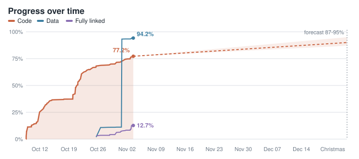
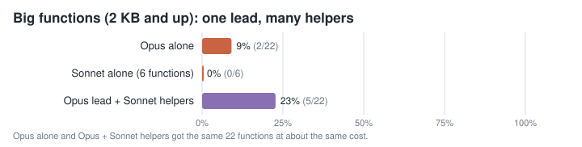
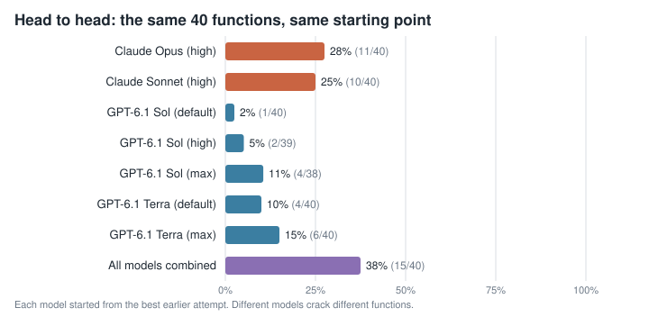
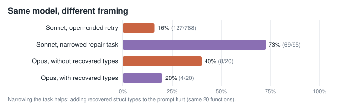
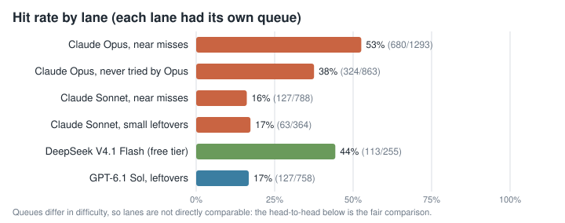

# Hybrid Heaven (N64) decompilation

A **matching decompilation** of *Hybrid Heaven* (Konami, 1999, USA) for the Nintendo 64: C source that compiles back to
a byte-identical ROM. It is also a **research project** on AI-driven decompilation: how far small and large models plus
good tooling get on real work, and what it costs. Every function is checked by the compiler, byte for byte.

[](https://decomp.dev/southcitycapture/hybridheaven-decomp)
· Live progress: [decomp.dev](https://decomp.dev/southcitycapture/hybridheaven-decomp) ·
[ByteMatch](https://bytematch.dev/southcitycapture/hybridheaven-decomp)

> **No game data is in this repository.** You need your own legally obtained ROM; disassembly is generated locally.

## Where it stands

| | Matched | |
|---|---:|---|
| **Code** | **78.75%** | 2,226,128 of 2,826,840 bytes |
| Functions | 96.2% | 15,286 of 15,891 |
| Data | 94.33% | 1,005,464 of 1,065,936 bytes |
| Fully linked | 13.82% | 175 of 538 source files complete |

_Updated 2026-11-06 10:06 UTC by the publishing loop._



**Fully linked** means a whole source file is C with nothing left in assembly, linked as a normal object. It trails
the code number because one unmatched function holds back its whole file.

## When will it be done?

Forecast as of 2026-11-03, re-estimated as the rate changes:

| Milestone | Estimate | Why |
|---|---|---|
| 85% of code | late November | The small and medium functions left are mostly within reach of the current lanes. |
| **90% of code** | **around Christmas 2026** (forecast range 87-95%) | Needs a good share of the big functions; the rate falls as the easier functions run out. |
| 100% of code | stretch goal for Christmas; more likely Q1 2027 | Every big function, including five of 8 KB or more, and the hardest register-allocation cases. |

Data and fully-linked progress follow the code: the remaining data sits in the same files as the unmatched functions.

The hard end is concentrated: functions of 2 KB or more hold about 41% of the bytes still to match, and our best method
for them currently lands between 1 in 8 and 1 in 4 per pass. That is where most of the remaining effort goes.

## What we've learned so far

- **Tooling matters as much as the model.** The same model goes from 16% to 73% when the task is narrowed: the working
  code as a starting point, a note saying what to fix, and a check inside the real file.
- **Models complement each other.** On the same 40 hard functions, Claude Opus matched 11 and the best GPT model 6, but
  all the models together matched 15: different models crack different functions.
- **Big functions want a team.** An Opus "lead" that splits a function into regions and hands them to Sonnet helpers
  matched 5 of 22 big functions; Opus alone matched 2 of the same 22, at about the same cost.
- **More context is not always better.** Adding recovered struct types to the prompt halved the hit rate (4 of 20
  against 8 of 20 without them).
- **Read the compiler's own reasoning.** IDO keeps its register-allocated intermediate code (`cc -K`). Our tracer reads
  it and tells a worker which variable ended up in the wrong register, and why.
- **Sister games pay off.** *Goemon's Great Adventure* comes from the same studio (KCE Osaka) and shares the sound,
  heap and file-loading code. Its build showed the original compiler flag (`-Wab,-r4300_mul`) that we had been
  imitating with a post-processing tool; switching to it landed 50 floating-point functions at once.
- **Model-free tools multiply every match.** Copying a match onto identical code elsewhere, and fitting matches into
  their files automatically, placed a large share of the functions in C without any model calls.
- **Small local models help at the edges.** A quantized Qwen 3.8 Flash on one workstation GPU (RTX A4000) matched
  about 1 in 8 of the leftovers it was given, at no API cost.
- **Running a swarm is an operations problem too.** Usage pacing across the week, failure recovery, integration checks
  and a privacy scan on every publish decided as much of the progress as model choice did.






More: [how it works](docs/METHOD.md) · [every batch's numbers](RESULTS.md) · [how the game is built](docs/TECHNICAL.md)

## Tools we built

Everything is in [`tools/hh`](tools/hh) (decomp tools) and [`tools/swarm`](tools/swarm) (running the AI workers).
Each script's docstring explains it in full. The main ones:

| Area | Tool | What it does |
|---|---|---|
| Choosing work | `pick.py`, `features.py` | Rank unmatched functions by expected matched bytes per unit of cost |
| | `similar.py`, `siblings.py` | Find already-matched look-alikes to give a worker as examples, with their C mapped onto the target |
| | `shape_groups.py` | Groups of identical unmatched functions: match one, and the rest follow |
| Helping a worker | `wall.py`, `diagnose.py` | Explain, without a model, why an attempt does not match yet |
| | `regtrace.py`, `ucode.py` | Register tracer: read IDO's intermediate code and show which C value got which register, and why |
| | `regsweep.py`, `regsearch.py` | Try meaning-preserving source changes one at a time (or as a beam search) and report what each does |
| | `regions.py`, `stitch.py` | Score big functions region by region, and stitch the best region from each attempt into one candidate |
| | `protofix.py` | Repair guessed declarations so workers aren't handed impossible prototypes |
| Matching without a model | `propagate.py` | Copy a match onto identical code elsewhere, with byte verification |
| | `unify.py`, `reconcile.py`, `addrfix.py` | Repair matches that fail only in their real file (declarations, addresses) |
| | `hidden_matches.py` | Find saved attempts that already match in their file although their batch recorded a miss |
| Building | `srcbuild.py`, `reconcile_frozen.py` | Assemble source files from the registry of matches and verify every function in context |
| | `gen_rodata_splits.py`, `data_to_c.py` | Give each file its own read-only data, and move initialized data from assembly into C |
| | `gen_libultra.py`, `idoflags.py` | Build the SDK library from source; keep the game's compiler flags in one place |
| The ROM | `lzkn.py`, `lzkn_enc.py` | Decoder and byte-matching encoder for Konami's LZ compression |
| | `filetable.py`, `expand.py`, `pack.py` | Read the game's file table, and unpack and repack the ROM |
| | `debug_strings.py` | Mine the leftover debug strings for source-file structure |
| Measuring | `progress.py`, `ledger.py` | The objdiff progress report (code, data, fully linked) and one source of truth for the numbers |
| Running the swarm | `loop.py` | Always-on loop: pick, run workers, verify, integrate, propagate, rebuild, check the ROM, publish |
| | `weekly_cap.py` | Pace model usage over the week as a ramp, not a cliff |
| | `live.py` | A live view of what every worker is doing |

## Our tools in other projects

The [Nagano Winter Olympics '98 decomp](https://github.com/TheGh0stShip/Nagano-Winter-Olympics-98-N64) (another
Konami N64 game, matched to 100% in about nine days) names this repository as its closest studio and toolchain
analogue. Its [upstream research](https://github.com/TheGh0stShip/Nagano-Winter-Olympics-98-N64/blob/main/analysis/upstream_research.md)
reviewed 13 of our tools and adapted ideas from several:

- `similar.py`: token similarity, 3-gram prefiltering and sequence scoring, applied in its function-family finder.
- `propagate.py`: copying proven source shapes, kept only behind independent byte verification.
- `protofix.py`: prototype consistency as a register-allocation check.
- `features.py`, `pick.py`: feature-based work ordering rather than size alone.
- `check_recompress.py`: decode and re-encode identity as a test gate for compressed files.

## Work from other teams we use

- **[Goemon's Great Adventure decomp](https://github.com/PandaPandel/Goemons-Great-Adventure-Decomp)** (CC0): the
  sister codebase. Its type definitions (adapted in `include/gga/`), names for 165 of our functions (as comments; our
  symbols are not renamed), C that matched 8 of our functions as templates, and the compiler flag above. Details in
  [docs/CREDITS.md](docs/CREDITS.md).
- **[ultralib](https://github.com/decompals/ultralib)**: the libultra 2.0J SDK sources we build the game's library from.
- **[HybridHeaven-Decomp](https://github.com/ogdanimal/HybridHeaven-Decomp)** (CC0): our libultra names were
  cross-checked against it. Its companion [HybridHeaven-Recomp](https://github.com/ogdanimal/HybridHeaven-Recomp) is a
  separate static-recompilation port (Windows, Linux, Android) if you want to play the game natively.
- The N64 decomp community's tools, listed under [Credits](#credits).

## Building

Linux (or WSL), Python 3.10+, git, curl, `make`, and MIPS binutils (`binutils-mips-linux-gnu`).

```sh
tools/setup.sh                                       # venv, splat, m2c, asm-processor, IDO, objdiff
cp /path/to/your/Hybrid\ Heaven\ \(USA\).z64 baserom/baserom.us.z64
. ./env.sh && make setup && make                     # regenerates asm/ locally, builds, checks the SHA-1
```

| ROM | SHA-1 |
|---|---|
| Hybrid Heaven (USA) (NHVE, rev 0) | `16dbc21620b52deab5c5abf8a309ac60adfbee85` |

## Contributing

Have your own Hybrid Heaven (USA) cartridge, a dumper and a Claude account? Run decomp workers on your own machine and
send back matched C: see [contrib/README.md](contrib/README.md). We assign functions in `contrib/tasks.json` and
re-verify every submission against the real ROM build before merging it.

## Research results

Per-batch numbers, generated from the run logs, are in [RESULTS.md](RESULTS.md). Costs there are API-equivalent
figures; the runs themselves used subscriptions (Claude Max, ChatGPT), free tiers and a local GPU.

## Credits

Built on the work of the N64 decomp community: [splat](https://github.com/ethteck/splat),
[spimdisasm](https://github.com/Decompollaborate/spimdisasm), [m2c](https://github.com/matt-kempster/m2c),
[asm-processor](https://github.com/simonlindholm/asm-processor), [asm-differ](https://github.com/simonlindholm/asm-differ),
[decomp-permuter](https://github.com/simonlindholm/decomp-permuter), [objdiff](https://github.com/encounter/objdiff),
[decomp.dev](https://decomp.dev), [ByteMatch](https://bytematch.dev), [ultralib](https://github.com/decompals/ultralib)
and [ido-static-recomp](https://github.com/decompals/ido-static-recomp). Thanks also to the
[Goemon's Great Adventure decomp](https://github.com/PandaPandel/Goemons-Great-Adventure-Decomp) authors.

Hybrid Heaven is © Konami. This project is not affiliated with Konami or Nintendo. Original code in this repository is
released under [CC0 1.0](LICENSE).
