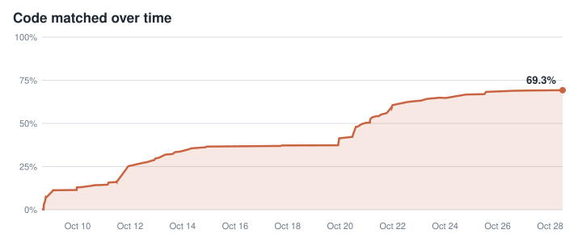
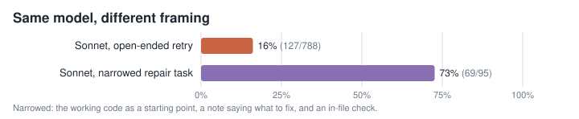
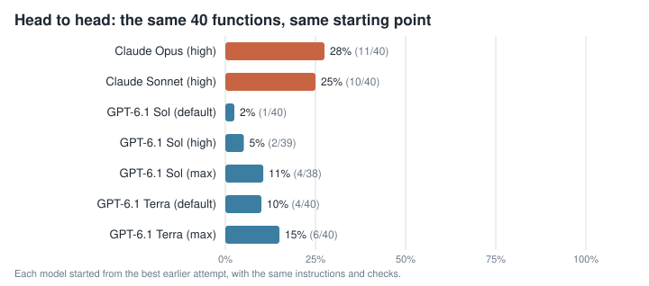
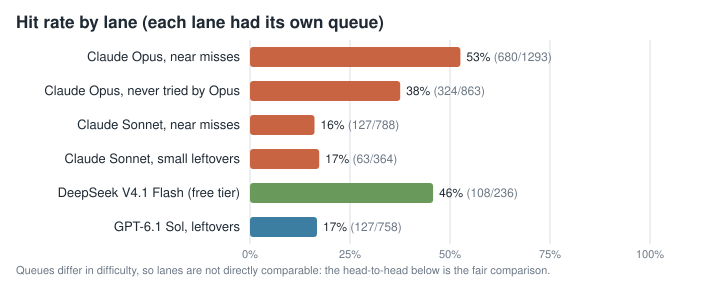

# Hybrid Heaven (N64) decompilation

A **matching decompilation** of *Hybrid Heaven* (Konami, 1999, USA) for the Nintendo 64: C source that compiles back to
a byte-identical ROM. It is also a **research project** on AI-driven decompilation: how far small and large models plus
good tooling get on real work, and what it costs. Every function is checked by the compiler, byte for byte.

[](https://decomp.dev/southcitycapture/hybridheaven-decomp)

> **No game data is in this repository.** You need your own legally obtained ROM; disassembly is generated locally.



## What we've learned so far

- **Tooling matters as much as the model.** The same model goes from 16% to 73% when the task is narrowed: the working
  code as a starting point, a note saying what to fix, and a check inside the real file.
- **The big model earns its place on the hard end.** Given the same 40 leftover functions and the same starting point,
  Claude Opus matched 11; the other models tried matched far fewer.
- **Model-free tools multiply every match.** Copying a match onto identical code elsewhere, and fitting matches into
  their files automatically, placed a large share of the functions in C without any model calls.
- **Running a swarm is an operations problem too.** Usage pacing, failure recovery and integration checks decided as
  much of the progress as model choice did.





Want to play it natively? [HybridHeaven-Recomp](https://github.com/ogdanimal/HybridHeaven-Recomp) is a separate
static-recompilation port (Windows, Linux, Android). Our libultra names were cross-checked against its companion
[decomp](https://github.com/ogdanimal/HybridHeaven-Decomp).

More: [how it works](docs/METHOD.md) · [every batch's numbers](RESULTS.md) · [how the game is built](docs/TECHNICAL.md)

## Building

Linux (or WSL), Python 3.10+, git, curl, `make`, and MIPS binutils (`binutils-mips-linux-gnu`).

```sh
tools/setup.sh                                       # venv, splat, m2c, asm-processor, IDO, objdiff
cp /path/to/your/Hybrid\ Heaven\ \(USA\).z64 baserom/baserom.us.z64
. ./env.sh && make setup && make                     # regenerates asm/ locally, builds, checks the SHA-1
```

| ROM | SHA-1 |
|---|---|
| Hybrid Heaven (USA) (NHVE, rev 0) | `16dbc21620b52deab5c5abf8a309ac60adfbee85` |

## Contributing

Have your own Hybrid Heaven (USA) cartridge, a dumper and a Claude account? Run decomp workers on your own machine and
send back matched C: see [contrib/README.md](contrib/README.md). We assign functions in `contrib/tasks.json` and
re-verify every submission against the real ROM build before merging it.

## Research results

Per-batch numbers, generated from the run logs, are in [RESULTS.md](RESULTS.md). Costs there are API-equivalent
figures; the runs themselves used subscriptions (Claude Max, ChatGPT) and free tiers.

## Credits

Built on the work of the N64 decomp community: [splat](https://github.com/ethteck/splat),
[spimdisasm](https://github.com/Decompollaborate/spimdisasm), [m2c](https://github.com/matt-kempster/m2c),
[asm-processor](https://github.com/simonlindholm/asm-processor), [asm-differ](https://github.com/simonlindholm/asm-differ),
[decomp-permuter](https://github.com/simonlindholm/decomp-permuter), [objdiff](https://github.com/encounter/objdiff),
[decomp.dev](https://decomp.dev), and [ido-static-recomp](https://github.com/decompals/ido-static-recomp).

Hybrid Heaven is © Konami. This project is not affiliated with Konami or Nintendo. Original code in this repository is
released under [CC0 1.0](LICENSE).
